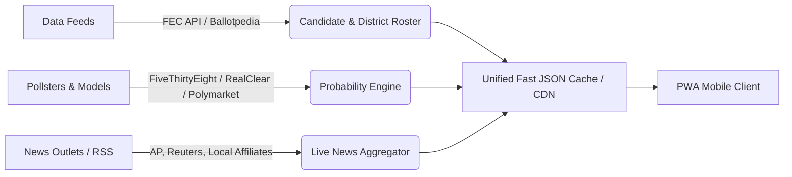

# US Midterm Elections Hub: Mobile-First PWA Architecture & Strategy Plan

## 1. Executive Overview & Goals

The platform is designed to be the go-to, lightning-fast mobile-first Progressive Web App (PWA) tracking the US Midterm Elections. It empowers voters, political analysts, and casual followers with:
- Granular race breakdowns: Senate, House (all 435 districts), and Gubernatorial races.
- Candidate profiles, backgrounds, fundraising stats, and head-to-head odds.
- Probability & Polling Aggregates (FiveThirtyEight/Silver-style polling averages + prediction market odds like Polymarket/Kalshi).
- Real-time live election news and state-by-state battleground feeds.
- High-visibility optimization for both **traditional search engines** (Google, Bing) and **Generative AI search engines** (ChatGPT Search, Perplexity, Gemini AI Overviews, Claude).

---

## 2. Recommended Technology Stack

| Layer | Recommended Choice | Rationale |
|---|---|---|
| **Core Architecture** | **Vite + React / Preact** or **Next.js (SSG/ISR)** | High mobile performance, sub-second TTFB, instant hydration, and pre-rendered pages for crawlers. |
| **Mobile PWA Layer** | **Workbox / Native Service Worker + Web App Manifest** | App icon on home screen, offline caching of candidate data, background sync, and push notifications for breaking race calls. |
| **Styling & UI** | **Vanilla CSS / Modern CSS Variables + Tailwind/PostCSS** | Native mobile feels, bottom sheet drawers, touch-gesture carousels, slick dark/light theme, zero bulky dependencies. |
| **Data Visualization** | **Lightweight SVG Charts & Hex Tile Map** (or D3/Recharts sub-bundle) | Fast rendering on low-tier mobile devices; interactive hex maps for US Senate/House seats. |
| **Data & News Feeds** | **JSON/REST Aggregation API + RSS/News Feed Sync** | Ingests polling averages, FEC finance stats, candidate rosters, and curated RSS news streams. |

---

## 3. Information Architecture & URL Hierarchy

A clean, predictable URL hierarchy is mandatory for both user navigation and SEO crawl budget:

```
/                             -> National Pulse Dashboard (Battle for Senate & House)
/senate                       -> Senate Overview & Toss-up Tracker
/senate/[state]               -> E.g. /senate/pennsylvania (Candidates, Win %, Polls)
/house                        -> House Map & Key Battleground Districts
/house/[state]-[district]     -> E.g. /house/tx-21, /house/ca-22
/governors                    -> 36 Gubernatorial Races
/governors/[state]            -> E.g. /governors/georgia
/candidates/[slug]            -> Detailed candidate dossiers
/live                         -> Live news ticker, updates, and key developments
/predictions                  -> Model methodology & probabilities overview
/llms.txt                     -> Dedicated LLM crawler summary (for AI search engines)
```

---

## 4. Mobile-First PWA User Experience (UX/UI)

### Key Mobile Features
1. **App Shell & Native Gestures**:
   - Bottom Tab Navigation bar: `[Dashboard]`, `[Senate]`, `[House]`, `[News]`, `[Search]`.
   - Top Header with Quick State/Zip Lookup drawer for instant "Who is on my ballot?" discovery.
   - Native-feeling Swipeable Battleground Cards and bottom sheet modals for detailed candidate views.
2. **Interactive Battleground Visualizer**:
   - Mobile-optimized SVG Hexagon Cartogram Map: Each state/district represented as equal-sized touch targets to avoid tiny state clipping on small screens.
   - Color-coded spectrum: Solid Dem, Lean Dem, Toss-up, Lean Rep, Solid Rep.
3. **Probability & Odds Meter**:
   - Dual-source indicator: Polling Aggregate (e.g. 51.2% vs 48.8%) vs Prediction Markets / Forecast model (e.g. 64% win probability).
4. **PWA Capabilities**:
   - `manifest.webmanifest`: Standalone display, theme color sync, custom badge icons.
   - Service worker offline cache: View downloaded candidate rosters and saved races on airplane mode or spotty mobile connections.
   - Web Push Notifications: Instant alerts for major seat rating shifts (e.g. "Cook Political Report shifts PA Senate from Lean D to Toss-Up").

---

## 5. Dual-Engine SEO & GEO Strategy

To rank #1 on Google/Bing and be heavily cited as the primary source by AI search tools (Perplexity, ChatGPT, Claude, Gemini):

### A. Traditional Search Engine Optimization (SEO)
1. **Pre-Rendering / SSG (Static Site Generation)**:
   - Ensure every state and district page (`/senate/pa`, `/house/oh-01`) exists as pre-rendered HTML with high text density.
2. **Schema.org Structured Data**:
   - `Person` schema for contestants (name, affiliation, politicalParty, image, jobTitle, url).
   - `Event` & `Election` schema for Midterm election dates and status.
   - `NewsArticle` schema for live news tracker updates.
   - `FAQPage` schema on every race page answering high-intent search queries:
     - *"Who is running for Senate in Pennsylvania 2026?"*
     - *"Who has the highest chance of winning TX-21?"*
3. **Keyword Clusters Targeted**:
   - Transactional / Informational queries: `[State] [Race] polls 2026`, `who is winning [District] election`, `US midterm win probability`, `[Candidate A] vs [Candidate B] odds`.

### B. Generative Engine Optimization (GEO) for AI Tools
1. **`llms.txt` and `llms-full.txt` Specification**:
   - Standardized markdown files at the root of the site specifically formatted for LLM crawlers (PerplexityBot, GPTBot, ClaudeBot, Google-Extended).
2. **Direct Answer Extraction Boxes (Factual Snippets)**:
   - Front-load each district page with an AI-digestible summary paragraph:
     > *"As of [Date], the [State/District] race is rated [Toss-up/Lean R/Lean D]. Candidate A leads Candidate B by [X]% in polling aggregate, with a win probability of [Y]%."*
3. **Markdown Mirrored Endpoints**:
   - Add `.md` extensions or content-negotiated raw text versions of race dossiers so AI scrapers receive clean markdown without client-side rendering hurdles.
4. **Authoritative Citation Architecture**:
   - Include clear attribution tables (polling source, sample size, date range, margin of error), which AI search algorithms prioritize when synthesizing answers.

---

## 6. Live News Tracker & Data Pipeline



1. **Static Baseline**: Candidate roster, historical past election results, district census stats.
2. **Dynamic Polling & Probability Feed**: Polling averages recalculated on update, cached with low TTL.
3. **Live News Feed**: RSS and news webhook parser filtering by tagged races (`tag: senate-pa`, `tag: tossups`), featuring timestamped live event cards.

---

## 7. Phased Implementation Roadmap

- **Phase 1: Project Foundation & Mobile PWA Scaffolding**
  - Setup modern mobile-first web framework with PWA manifest, service worker, responsive viewport layouts, and dark/light mode.
  - Implement bottom navigation, sticky header, and search bar.
- **Phase 2: Comprehensive Election Data Store & Models**
  - Build mock/real structured datasets for Senate, House key toss-ups, and Gubernatorial races with win probabilities, poll stats, candidate photos/details.
- **Phase 3: Interactive Race & District Detail Views**
  - Dynamic route views for Senate, House, and Governor seats.
  - Win probability gauge, polling timeline chart, candidate comparison cards, and FAQ accordion.
- **Phase 4: Live News Tracker & Battleground Pulse**
  - Real-time live ticker component with filter by state/chamber, breaking badge alerts, and bookmarking.
- **Phase 5: SEO & GEO Implementation**
  - Dynamic OpenGraph tags, JSON-LD Schema markup for Google/Bing, `llms.txt`, robots.txt, and sitemap generator.
